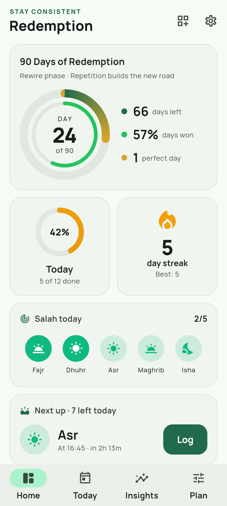
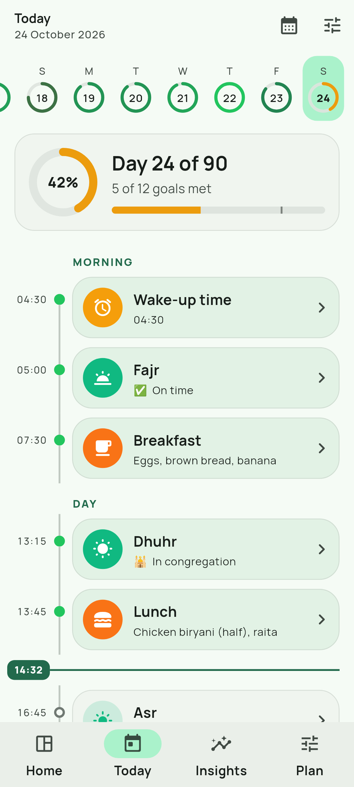
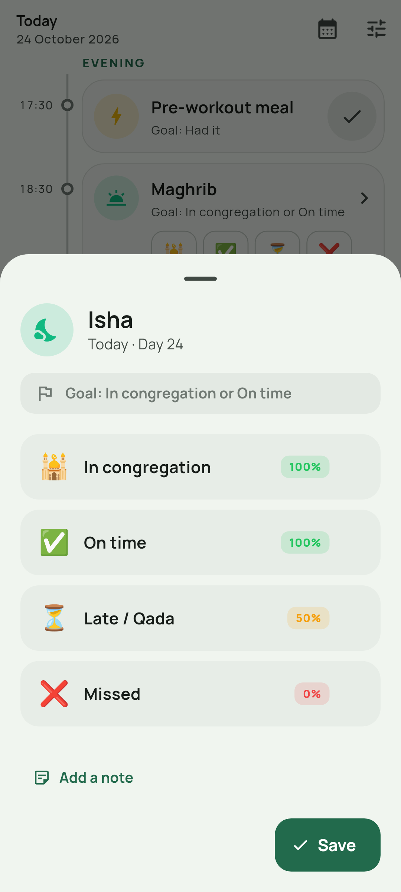
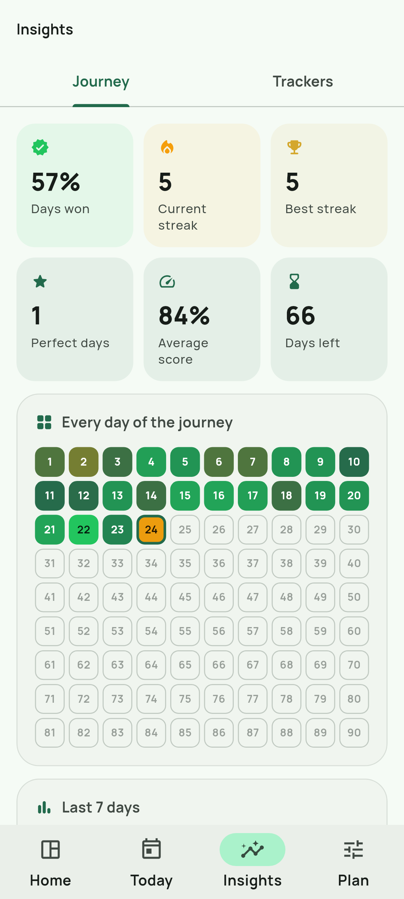

<div align="center">


# Redemption

**Rewire your brain in 90 days.**

A fully customisable daily-discipline tracker for Android (iOS-ready).
Define anything you want to show up for, log it in one tap,
and watch the new neural pathway grow.

</div>

<p align="center">
  
  
  
  
</p>

---

## Why

Every time you do the hard thing, the circuit behind it gets a little stronger
and the old one a little weaker. In a UCL study (Lally et al., 2010) a new daily
behaviour took a median of **66 days** to become automatic. Redemption gives you
90 days — the median plus a margin to lock it in — split into three phases:

| Phase | Days (of 90) | What happens |
|---|---|---|
| **Uproot** | 1–21 | Old pathways fire loudest. Show up anyway. |
| **Rewire** | 22–66 | Repetition builds the new road. Never miss twice. |
| **Redeem** | 67–90 | It becomes automatic. Own it. |

Journeys can be any length (7–365 days); phases scale proportionally.

## Features

**Track anything, your way**
- 13 input types: Yes/No · single choice (each option has its own credit) ·
  multiple choice (add tags on the fly) · time of day · duration · counter ·
  number · decimal · rating (stars / emoji / 1–10) · short text · notes · photo · file.
- Goals per tracker: *log it*, yes-is-the-win **or no-is-the-win** (for quitting habits — the
  one-tap button then logs the “No”, shown as a green ✗),
  at least / at most / between (with partial credit), before / after a time (with a grace window),
  or option-based credit (e.g. prayer *in congregation* 100 %, *late* 50 %, *missed* 0 %).
- Planned time, section, weekday schedule, optional vs. required, per-tracker reminders.

**Input that isn't just a keyboard**
- One-tap actions right on the timeline: ✓, “Now”, +1, or the option emoji.
- Scroll wheels for times and durations, hold-to-accelerate steppers, sliders, preset chips.
- Text trackers learn from your history: tap-to-add chips (“Oats”, “Eggs”…) and “Same as yesterday”.
- Camera / gallery / document attachments stored privately on device.
- Live goal feedback while you log (“Goal met”, “Partial credit · 75 %”).

**A dashboard you design**
12 widgets you can add, remove, reorder and resize (half or full width):
journey ring (day X of N + consistency), today, streak, next up, quick strip
(e.g. the 5 daily prayers), tracker rings (progress towards all N days),
journey grid heat-map, trend charts with target lines, last 7 days, stat tiles,
rewiring phase, intention & daily quote.

**Insight & observability**
- Day score, winning-day threshold, current/best streaks, perfect days, consistency.
- Per-tracker success rate, streaks, averages (time-of-day averages done correctly across midnight),
  totals, option breakdowns, photo gallery, full history (editable).
- Logical day boundary (default 03:00) so a 00:40 bedtime counts for the right day.
- On-device Diagnostics: structured logs (ring buffer + rotating file), DB/storage stats,
  reminder status — shareable when you need to debug. No telemetry, ever.

**Yours, privately**
- Everything is local (SQLite). No account needed, no server of ours.
- Optional **Google Drive backup** into a hidden app folder of *your* Drive: automatic,
  versioned (one snapshot per day, 10 kept), never uploads an empty app, and a fresh install
  can restore its journey from the welcome screen. One-time Google Cloud setup:
  [docs/google-drive-setup.md](docs/google-drive-setup.md).
- Full ZIP backup (data + photos) and restore; CSV export for Sheets/pandas.
- **In-app updates** from this repo's GitHub releases: checks on start-up/resume, downloads the
  APK for your phone's CPU in the background, verifies it against the release's `SHA256SUMS.txt`
  and hands it to Android's installer (you confirm with one tap). *Settings → App updates*.
- Android Auto Backup covers the database.

**Built for everyone**
- Material 3, light / dark / pure-black, Material You dynamic colour or 8 accent seeds.
- TalkBack labels on every ring, chart and grid cell; live regions for scores;
  48 dp touch targets; respects “remove animations”; tested at 200 % font size.
- Haptics and a little confetti on perfect days (both optional).

**Templates** to start fast: *Redemption — Muslim daily discipline* (wake-up, the five prayers,
meals, WFH/office, pre-workout, workout, sleep), *Body recomposition*, *Deep work & learning*,
*Break a bad habit*, or start from scratch.

## Get the app

### Download the APK

Grab the latest build from **[Releases](https://github.com/yasirfaizahmed/redemption/releases/latest)**:

1. Download **`redemption-<version>-universal.apk`** (works on every phone;
   `…-arm64-v8a.apk` is a smaller build for almost all modern phones).
2. Open it on your phone and allow “install unknown apps” when prompted.
3. Future releases install straight over the old version — your data is kept.

Every push to any branch also builds APKs: **Actions → CI → latest run → `redemption-android`**
artifact (named `redemption-build-<n>-*.apk`).

### Publishing a release

Add a `## <version>` section to [`CHANGELOG.md`](CHANGELOG.md) and bump `version:` in
`pubspec.yaml` first: CI copies that section into the release as **What's new**, and the
in-app updater shows it before updating. Installed apps (v1.1.0+) find the release on their
next start.

1. Bump `version:` in `pubspec.yaml` (e.g. `1.1.0+1`) and push to `master`.
2. Either click **Actions → CI → Run workflow**, tick **release**, run on `master`
   (GitHub creates the `v1.1.0` tag for you), or push a tag yourself:

   ```bash
   git tag -a v1.1.0 -m "Redemption v1.1.0" && git push origin v1.1.0
   ```

Both paths run the full CI (tests → APKs + Play `.aab`) and publish a GitHub Release with
the APKs, the bundle and `SHA256SUMS.txt`. Releasing a version whose tag already exists is
refused, so a release is never overwritten by accident. `versionName` comes from the tag and `versionCode`
is `10000 + CI run number` for **every** APK (universal and per-ABI alike — see
`android/gradle.properties`), so any build installs over any older one.

> Builds are signed with a shared **dev** key committed to the repo, so every new APK
> installs over the previous one and keeps your data. For a Play Store release, add your own
> key as secrets (see [Signing](#signing)).

### Build it yourself

Requirements: Flutter **3.47.7** (stable), Android SDK 36, JDK 17.

```bash
flutter pub get
flutter run                            # debug on a connected device / emulator
flutter build apk --release            # build/app/outputs/flutter-apk/app-release.apk
```

## Architecture

```
lib/
├── main.dart              bootstrap: logging, global error capture, DB, notifications
├── app/                   MaterialApp, go_router (StatefulShellRoute), theme, palette
├── core/                  Day (DST-safe local date), clock helpers, logger, shared widgets
├── domain/                pure Dart: tracker types/config/goals/values, scoring engine,
│                          analytics (streaks, stats, series), templates, phases, quotes
├── data/                  Drift (SQLite) schema + type converters, repositories,
│                          attachment store, ZIP/CSV backup
├── services/              local notifications (timezone-aware, exact/inexact fallback),
│                          Google Drive backup (REST client, authorization, snapshots),
│                          in-app updates (GitHub releases, verified download, installer)
├── state/                 Riverpod providers (reactive streams → derived analytics), actions
└── features/              onboarding · dashboard (+ editor) · today · entry sheet & inputs ·
                           plan & tracker editor · insights · journey · settings · diagnostics
```

- **Flutter + Material 3** (`material_ui`), one codebase for Android and iOS.
- **Riverpod 3** for state: DB streams feed derived providers (`journeyStatsProvider`,
  `trackerStatsProvider(id)`…), so every screen updates live and only recomputes when inputs change.
- **Drift** for type-safe, reactive SQLite with JSON type converters, foreign keys,
  cascade deletes, unique `(tracker, day)` entries and a migration hook.
- **Clean layering**: the domain layer is pure Dart with no Flutter or DB imports in its logic, and is unit-tested
  in isolation. Persistence maps rows ↔ domain models; UI only talks to providers.
- Values, goals and configs are versioned JSON (`{"t": …, "v": …}`) — forward compatible and
  portable through backups.

## Quality

```bash
flutter analyze                         # strict lints, zero issues
dart format --set-exit-if-changed lib test
flutter test                            # 85+ unit, repository & widget tests
SCREENSHOTS=1 flutter test test/screenshots --update-goldens   # regenerate docs/screenshots
```

Tests cover the day boundary and DST arithmetic, every goal type, streak rules
(“an unfinished today never breaks a streak”), midnight-safe time averages, JSON round trips,
repositories (cascade, upsert, slotting, archive, backup restore), the Drive client (paging,
resumable upload, token refresh) and snapshot rules (daily versions, pruning, device settings
kept on restore), and full app flows (onboarding, one-tap logging incl. quit-style Yes/No,
connecting Drive, restoring a fresh install from Drive, creating a tracker, 200 % text scale
on every tab).

CI (`.github/workflows/ci.yml`) runs codegen drift checks, formatting, analysis and tests,
then builds APKs (and an AAB + GitHub Release on `v*` tags). The workflow token is read-only
except for the release step. A macOS job verifies the iOS build on tags (or manually via
`workflow_dispatch` with *ios = true*).

## Signing

Release builds use `android/key.properties` when present, otherwise the shared dev key.
For your own upload key, add these repository secrets and CI will use them automatically:

| Secret | Value |
|---|---|
| `ANDROID_KEYSTORE_BASE64` | `base64 -w0 upload.jks` |
| `ANDROID_KEYSTORE_PASSWORD` | keystore password |
| `ANDROID_KEY_ALIAS` | key alias |
| `ANDROID_KEY_PASSWORD` | key password |

> Switching from the dev key to your own key changes the app signature: export a backup
> first, reinstall, then restore.

## iOS

The project is iOS-ready (camera/photo permission strings, notification delegate, icons).
On a Mac: `cd ios && pod install`, open `Runner.xcworkspace`, pick your team, run.

## Roadmap ideas

- Home-screen widget (today’s ring + next item).
- Prayer-time aware reminders (location-based adhan times).
- End-to-end encrypted Drive backups (passphrase).

---

*“Indeed, Allah will not change the condition of a people until they change what is in
themselves.”* — Qur’an 13:11
